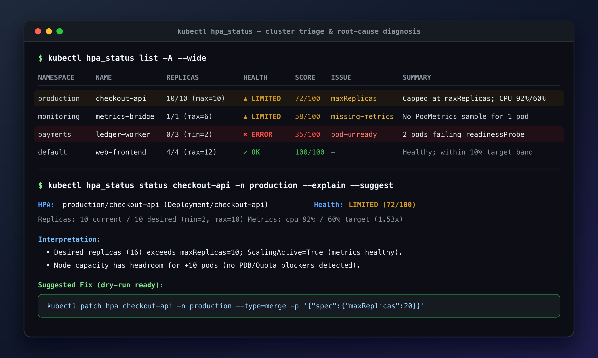
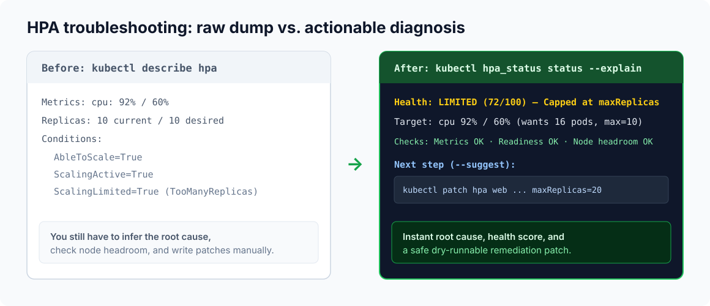

# kubectl-hpa-status

[](https://github.com/mattsu2020/kubectl-hpa-status/actions/workflows/ci.yml)
[](https://pkg.go.dev/github.com/mattsu2020/kubectl-hpa-status)
[](https://goreportcard.com/report/github.com/mattsu2020/kubectl-hpa-status)
[](https://github.com/mattsu2020/kubectl-hpa-status/releases)
[](LICENSE)

<details>
<summary><strong>その他のバッジ</strong></summary>
<br>

[](https://github.com/mattsu2020/kubectl-hpa-status/actions/workflows/codeql.yml)
[](https://github.com/mattsu2020/kubectl-hpa-status/actions/workflows/release.yml)
[](https://github.com/mattsu2020/kubectl-hpa-status/stargazers)
[](https://goreleaser.com/)
[](https://golangci-lint.run/)
[](https://krew.sigs.k8s.io/plugins/)
[](https://kubernetes.io/docs/tasks/run-application/horizontal-pod-autoscale/)
[](https://codecov.io/gh/mattsu2020/kubectl-hpa-status)

</details>



**「なぜ HPA がスケールしないのか？」をもう手作業で追う必要はありません。**
`kubectl-hpa-status` は、Kubernetes の HPA Condition・メトリクス・Pod Readiness・イベントを自動で突き合わせ、**原因の言語化・ヘルススコア算出・安全な修正パッチ提案**をワンコマンドで行う kubectl プラグインです。**クラスタへのエージェントや CRD の導入は一切不要**です。

English README: [README.md](README.md)

### 主な特徴

- **原因がひと目でわかる (`status --explain`, `doctor`)**: 正常稼働か、`maxReplicas` 上限到達か、スケールダウン安定化待機中か、Pod の `requests` 未設定による計算不能か、メトリクス取得失敗かを即座に特定します。
- **クラスタ全体の一括トリアージ & 対話型 TUI (`list --problem`, `scan`, `tui`)**: 全 Namespace から問題のある HPA だけを瞬時に抽出。スパークラインやドリルダウンを備えた対話型ダッシュボード (`tui`) も搭載しています。
- **安全な修正提案 & シミュレーション (`--suggest`, `--simulate-metric`, `alpha backtest`)**: そのまま使える `kubectl patch` の生成・Dry-Run 適用、負荷急増時の What-If シミュレーション、記録データや Prometheus 履歴を用いたバックテスト検証に対応。
- **既存環境でそのまま動く**: KEDA `ScaledObject` の管理状態、VPA との競合、ロールアウト中の足止め、ノード容量不足を標準 Kubernetes API の読み取りだけで診断します。

## Before / After

<table>
<tr>
<th>Before: 生の <code>kubectl describe hpa</code></th>
<th>After: <code>kubectl hpa_status status web --explain</code></th>
</tr>
<tr>
<td>
<pre><code>Name: web
Namespace: production
Metrics: cpu: 92% / 60%
Min replicas: 2
Max replicas: 10
Deployment pods: 10 current / 10 desired
Conditions:
  AbleToScale=True
  ScalingActive=True
  ScalingLimited=True
Events:
  SuccessfulRescale New size: 10</code></pre>
</td>
<td>
<pre><code>web production  [LIMITED] (score: 75/100)
Summary: maxReplicasの上限に到達
Replicas: 10 current / 10 desired (min=2, max=10)
CPU: 92% / 60% target

Interpretation:
- HPAはさらに増やしたいが、maxReplicas=10で制限されています。
- ScalingActive=Trueのため、メトリクスは取得できています。

Recommended actions:
- 容量を確認し、--suggestでmaxReplicas引き上げ案をdry-runします。</code></pre>
</td>
</tr>
</table>

## デモ



| ワークフロー | 画像 | 録画 |
| --- | --- | --- |
| `status --explain` | [status-explain.svg](images/status-explain.svg) | [cast](docs/status-explain.cast) |
| `doctor` 包括診断 | [doctor.svg](images/doctor.svg) | [cast](docs/doctor.cast) |
| `list -A --wide --problem` | [list-wide.svg](images/list-wide.svg) | [cast](docs/list-wide.cast) |
| `scan` クラスタ診断 | [scan-demo.svg](images/scan-demo.svg) | [cast](docs/scan.cast) |
| `timeline --since=30m` | [timeline.svg](images/timeline.svg) | [cast](docs/timeline.cast) |
| `recommend` ベストプラクティス監査 | [recommend.svg](images/recommend.svg) | [cast](docs/recommend.cast) |
| `--simulate-metric` シミュレーション | [simulate.svg](images/simulate.svg) | [cast](docs/simulate.cast) |
| TUI インタラクティブダッシュボード | [tui.svg](images/tui.svg) | [cast](docs/tui.cast) |
| `watch --interval 5s` | [watch-mode.svg](images/watch-mode.svg) | [cast](docs/watch.cast) |
| `--suggest` → `--fix --apply` | [apply-diff.svg](images/apply-diff.svg) | [cast](docs/fix-flow.cast) |
| 日本語ラベル (`--lang=ja`) | [ja-output.svg](images/ja-output.svg) | |
| JSON出力 | [json-output.svg](images/json-output.svg) | |
| メトリクス取得失敗 | [metrics-failure.svg](images/metrics-failure.svg) | |
| スケールダウン安定化 | [stabilized-output.svg](images/stabilized-output.svg) | |
| 複数メトリクス推定 | [multi-metric-output.svg](images/multi-metric-output.svg) | |

## 5分で始める

### 1. 10秒でインストール

```sh
# Krew 経由（macOS / Linux / Windows）
kubectl krew install hpa-status

# または Homebrew 経由（macOS）
brew install mattsu2020/kubectl-hpa-status/kubectl-hpa-status
```

### 2. 自分のクラスタで試す

```sh
# クラスタ全体から問題のある HPA を抽出
kubectl hpa_status list -A --problem

# スケールしない原因の解説と修正提案を表示
kubectl hpa_status status <hpa-name> -n <namespace> --explain --suggest

# 対話型 TUI ダッシュボードを起動
kubectl hpa_status tui -A
```

### 3. 同梱のサンプルマニフェストで試す（事前準備不要）

```sh
kubectl apply -f examples/cpu-memory-hpa.yaml
kubectl hpa_status status web-multi -n hpa-status-examples --explain
kubectl hpa_status status web-multi -n hpa-status-examples --suggest
kubectl hpa_status list -n hpa-status-examples --wide
```

## インストール

### Krew（推奨）

```sh
kubectl krew install hpa-status
```

> **コマンド名のヒント**: Krew でインストールすると `kubectl-hpa_status` として配置され、`kubectl hpa_status <command>` で呼び出せます。Homebrew や `go install` で導入した場合は `kubectl-hpa-status <command>` としても直接実行できます。

### Homebrew (macOS)

```sh
brew install mattsu2020/kubectl-hpa-status/kubectl-hpa-status
kubectl-hpa-status list -A --wide
```

### ソースからビルド

```sh
go build -o kubectl-hpa-status .
sudo mv ./kubectl-hpa-status /usr/local/bin/
kubectl-hpa-status status <hpa-name> -n <namespace>
```

### 必要要件と RBAC

- **Kubernetes 1.26+**（`autoscaling/v2`）および設定済みの `kubeconfig`
- `metrics-server`（CPU/メモリ用）またはカスタム/外部メトリクスアダプター
- **最小 RBAC 対応**: オプションなしの `status <hpa>` は **HPA オブジェクトのみ** を読み取ります。より深い診断フラグを指定したときだけ段階的に Pod / Event 等を読み取ります（詳細は [docs/rbac.yaml](docs/rbac.yaml)）:

| コマンド | 読み取るリソース | 使いどき |
| --- | --- | --- |
| `status <hpa>` | HPA 本体のみ | 高速なヘルスチェック・強い RBAC 制限がある環境 |
| `status <hpa> --explain` | + コンディション、イベント、ターゲット Pod | 「なぜこの挙動なのか？」を知りたいとき |
| `status <hpa> --explain-pods` | + Pod 単位の Readiness・リソース requests | 未準備 Pod や requests 歪みの診断 |
| `status <hpa> --deep` | + キャパシティ、ロールアウト、アダプタ診断 | スケールアウト阻害要因の網羅調査 |
| `status <hpa> --no-enrich` | HPA 本体のみ（明示、別名 `--hpa-only`） | プリセット有効時でも HPA 読み取りのみに固定 |

## 代表コマンド

### 困ったときの逆引きチートシート

| 知りたいこと・やりたいこと | 実行するコマンド |
| --- | --- |
| **「今クラスタ内で異常・上限到達している HPA はどれ？」** | `kubectl hpa_status list -A --problem` |
| **「なぜこの HPA はスケールアップ／ダウンしないの？」** | `kubectl hpa_status status <hpa> -n <ns> --explain` |
| **「メトリクス・プローブ・容量・KEDA/VPA を丸ごと診断したい」** | `kubectl hpa_status doctor <hpa> -n <ns>` |
| **「複数メトリクスのうちどれがレプリカ数を決めている？」** | `kubectl hpa_status doctor trace <hpa> -n <ns>` |
| **「もし CPU が 85% に上がったら何 Pod にスケールする？」** | `kubectl hpa_status status <hpa> -n <ns> --simulate-metric cpu=85%` |
| **「安全な修正パッチを作って Dry-Run 検証したい」** | `kubectl hpa_status status <hpa> -n <ns> --suggest --fix --dry-run` |
| **「直近 30 分間（または Prometheus 履歴）の推移を見たい」** | `kubectl hpa_status timeline <hpa> -n <ns> --since=30m` |
| **「HPA 設定案を過去の実負荷履歴でバックテスト比較したい」** | `kubectl hpa_status alpha backtest <hpa> -n <ns> --from-record record.jsonl` |
| **「HPA の変化をリアルタイムに監視したい」** | `kubectl hpa_status watch <hpa> -n <ns> --watch-mode=informer` |

### コピー＆ペーストで使える基本コマンド

```sh
# 1. 詳細なステータスと解釈・次のアクションを表示
kubectl hpa_status status <hpa> -n <ns> --explain

# 2. スケール失敗時の包括診断
kubectl hpa_status doctor <hpa> -n <ns>

# 3. クラスタ全体の問題のあるHPA一覧
kubectl hpa_status list -A --problem

# 4. kubectl patchコマンドとして修正提案を表示
kubectl hpa_status status <hpa> --suggest

# 5. クラスタ全体のHPA問題をスキャン
kubectl hpa_status scan
```

### コマンド体系

日常運用で使う基本コマンドから、深い原因調査・GitOps・履歴検証まで4つのレイヤーに整理されています:

| レイヤー | コマンド | 用途 |
| --- | --- | --- |
| **基本 (Basic)** | `status`, `list`, `scan`, `doctor`, `watch`, `explain`, `tui` | 日常のヘルスチェック・一覧トリアージ・リアルタイム監視 |
| **調査 (Investigation)** | `doctor trace`, `doctor path`, `timeline`, `metrics`, `recommend`, `blockers`, `rollout`, `compare` | 根本原因の深掘り・ベストプラクティス監査 |
| **運用 (`alpha`)** | `alpha policy`, `alpha gitops`, `alpha bundle`, `alpha incident-bundle`, `alpha support-bundle` | CI/CD ポリシーゲート、GitOps ドリフト検査、マスク済み調査バンドル出力 |
| **実験的 (`alpha`)** | `alpha backtest`, `alpha analyze-record`, `alpha capacity`, `alpha capacity-gap`, `alpha autoscaler-map`, `alpha flap` | 履歴バックテスト、周期性（Seasonality）検出、キャパシティ計画 |

## 例

実践的なサンプルマニフェストは [examples/](examples/) に同梱されています:

```sh
kubectl apply -f examples/cpu-memory-hpa.yaml
kubectl hpa_status status web-multi -n hpa-status-examples --explain --suggest
kubectl hpa_status list -n hpa-status-examples --wide
```

### 日本語表示 (`--lang=en|ja`)

`--lang=en|ja` を指定すると、テーブル見出し・セクション名・サマリー行が日本語化されます。JSON/YAML のフィールド名や機械処理用の enum 値は言語に依存しないため、スクリプトの互換性はそのまま維持されます。

### 複数 HPA 指定と Exit Code（CI / 自動化向け）

`status NAME1 NAME2 ...` のように複数 HPA を指定した場合、一部の HPA が取得失敗しても処理全体を止めずに **Partial Result（部分結果）** を返します:

| 結果状態 | Exit code |
| --- | --- |
| すべての HPA が正常 (`OK`) | `0` |
| 1つ以上の HPA が `LIMITED` / `ERROR`（API 取得エラーなし） | `2` |
| 対象の HPA が存在しない (`ErrHPANotFound`) | `3` |
| API エラーまたは実行時エラー | `1` |

構造化出力（`-o json`, `-o yaml`, `-o jsonl`）はグループ化された `hpa-status/v2` スキーマ（`docs/output-schema-v2.json`）を使用します:

```json
{
  "apiVersion": "hpa-status/v2",
  "items": [
    {
      "namespace": "default",
      "name": "web",
      "status": "ok",
      "report": {
        "apiVersion": "hpa-status/v2",
        "analysis": {
          "meta": { "name": "web", "namespace": "default" },
          "decision": { "health": "OK", "healthScore": 100 }
        }
      }
    },
    {
      "namespace": "default",
      "name": "missing",
      "status": "error",
      "error": "HPA \"missing\" was not found in namespace \"default\""
    }
  ]
}
```

## ドキュメント

| ドキュメント | 内容 |
| --- | --- |
| [Usage Guide](docs/usage.md) | 全フラグ一覧、設定ファイル、ヘルススコア計算、JSONPath 例 |
| [TUI Manual](docs/tui.md) | 対話型ダッシュボードの操作方法、ショートカット、修正/シミュレーション画面 |
| [Reference](docs/reference.md) | Doctor 診断項目、安全な修正フロー、マルチメトリクストレース、シミュレータ詳細 |
| [Troubleshooting](docs/troubleshooting.md) | 症状別の逆引きランブックと FAQ |
| [Roadmap](ROADMAP.md) | 今後のマイルストーンとアーキテクチャ計画 |
| [Promotion Kit](docs/social-promotion.md) | SNS・勉強会・記事向けの紹介テンプレート |

## コミュニティとプロモーション

- インシデント対応や日々の HPA 運用に役立った場合は、ぜひリポジトリの Star や Fork をお願いします。
- デモ画像 [images/demo.png](images/demo.png) や [images/](images/) 内のスクリーンショットはチーム内共有や紹介記事で自由にご活用ください。
- 紹介テンプレートは [docs/social-promotion.md](docs/social-promotion.md) にまとまっています。
- 機能要望や判断に迷う HPA のケースがあれば、お気軽に Issue や Discussions で共有してください。

## ロードマップ

開発ロードマップは [ROADMAP.md](ROADMAP.md) で管理しています。直近では Prometheus 履歴インポート（`--from-prometheus`）、`alpha backtest`、Informer ベースの Watch モード（`--watch-mode=informer`）、大規模クラスタ向け TUI のオンデマンドレポート生成を実装しました。

## 開発

```sh
make build
make test
make coverage
make docs-check
make lint
```

- [ARCHITECTURE.md](ARCHITECTURE.md)
- [SECURITY.md](SECURITY.md)
- [CONTRIBUTING.md](CONTRIBUTING.md)

## ライセンス

Apache-2.0
