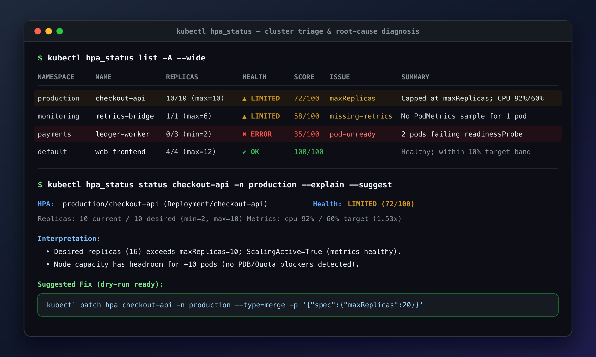
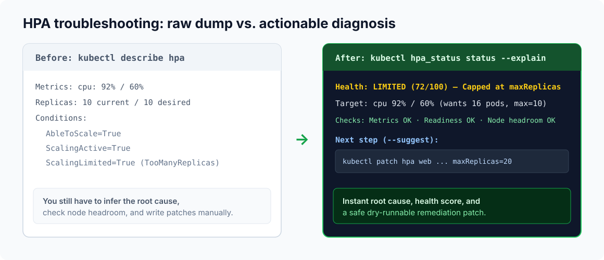

# kubectl-hpa-status

[](https://github.com/mattsu2020/kubectl-hpa-status/actions/workflows/ci.yml)
[](https://pkg.go.dev/github.com/mattsu2020/kubectl-hpa-status)
[](https://goreportcard.com/report/github.com/mattsu2020/kubectl-hpa-status)
[](https://github.com/mattsu2020/kubectl-hpa-status/releases)
[](LICENSE)

<details>
<summary><strong>Additional badges</strong></summary>
<br>

[](https://github.com/mattsu2020/kubectl-hpa-status/actions/workflows/codeql.yml)
[](https://github.com/mattsu2020/kubectl-hpa-status/actions/workflows/release.yml)
[](https://github.com/mattsu2020/kubectl-hpa-status/stargazers)
[](https://goreleaser.com/)
[](https://golangci-lint.run/)
[](https://krew.sigs.k8s.io/plugins/)
[](https://kubernetes.io/docs/tasks/run-application/horizontal-pod-autoscale/)
[](https://codecov.io/gh/mattsu2020/kubectl-hpa-status)

</details>



**Stop guessing why your HorizontalPodAutoscaler is not scaling.**
`kubectl-hpa-status` turns raw Kubernetes HPA conditions, metrics, pod readiness, and cluster events into a clear root-cause explanation, health score, and safe remediation plan — with **zero in-cluster agents or CRDs required**.

Japanese README: [README.ja.md](README.ja.md)

### Why `kubectl-hpa-status`?

- **Instant root-cause answers (`status --explain`, `doctor`)**: Immediately see whether an HPA is healthy, capped at `maxReplicas`, waiting on scale-down stabilization, blocked by missing pod resource `requests`, or failing to read metrics.
- **Cluster-wide triage & interactive TUI (`list --problem`, `scan`, `tui`)**: Spot unhealthy HPAs across all namespaces in seconds, or launch the interactive terminal dashboard (`tui`) with live sparklines and drill-down views.
- **Safe fixes & what-if simulation (`--suggest`, `--simulate-metric`, `alpha backtest`)**: Generate ready-to-run `kubectl patch` commands, preview metric spikes before they happen, or backtest candidate configs against recorded / Prometheus history.
- **Works with your existing stack**: Detects KEDA `ScaledObject` ownership, VPA resource conflicts, rollout bottlenecks, and cluster capacity ceilings using standard read-only Kubernetes API calls.

## Before / After

<table>
<tr>
<th>Before: raw <code>kubectl describe hpa</code></th>
<th>After: <code>kubectl hpa_status status web --explain</code></th>
</tr>
<tr>
<td>
<pre><code>Name: web
Namespace: production
Metrics: cpu: 92% / 60%
Min replicas: 2
Max replicas: 10
Deployment pods: 10 current / 10 desired
Conditions:
  AbleToScale=True
  ScalingActive=True
  ScalingLimited=True
Events:
  SuccessfulRescale New size: 10</code></pre>
</td>
<td>
<pre><code>web production  [LIMITED] (score: 75/100)
Summary: limited at maxReplicas
Replicas: 10 current / 10 desired (min=2, max=10)
CPU: 92% / 60% target

Interpretation:
- HPA wants more replicas, but maxReplicas=10 caps it.
- ScalingActive=True, so metrics are available.

Recommended actions:
- Check capacity, then raise maxReplicas with --suggest.</code></pre>
</td>
</tr>
</table>

## Demo



| Workflow | Visual | Recording |
| --- | --- | --- |
| `status --explain` | [status-explain.svg](images/status-explain.svg) | [cast](docs/status-explain.cast) |
| `doctor` full diagnostics | [doctor.svg](images/doctor.svg) | [cast](docs/doctor.cast) |
| `list -A --wide --problem` | [list-wide.svg](images/list-wide.svg) | [cast](docs/list-wide.cast) |
| `scan` cluster triage | [scan-demo.svg](images/scan-demo.svg) | [cast](docs/scan.cast) |
| `timeline --since=30m` | [timeline.svg](images/timeline.svg) | [cast](docs/timeline.cast) |
| `recommend` best practice audit | [recommend.svg](images/recommend.svg) | [cast](docs/recommend.cast) |
| `--simulate-metric` what-if | [simulate.svg](images/simulate.svg) | [cast](docs/simulate.cast) |
| TUI interactive dashboard | [tui.svg](images/tui.svg) | [cast](docs/tui.cast) |
| `watch --interval 5s` | [watch-mode.svg](images/watch-mode.svg) | [cast](docs/watch.cast) |
| `--suggest` → `--fix --apply` | [apply-diff.svg](images/apply-diff.svg) | [cast](docs/fix-flow.cast) |
| Japanese labels (`--lang=ja`) | [ja-output.svg](images/ja-output.svg) | |
| JSON output | [json-output.svg](images/json-output.svg) | |
| Metrics failure | [metrics-failure.svg](images/metrics-failure.svg) | |
| Scale-down stabilization | [stabilized-output.svg](images/stabilized-output.svg) | |
| Multi-metric estimation | [multi-metric-output.svg](images/multi-metric-output.svg) | |

## Quick Start

### 1. Install in 10 seconds

```sh
# Via Krew (macOS / Linux / Windows)
kubectl krew install hpa-status

# Or via Homebrew (macOS)
brew install mattsu2020/kubectl-hpa-status/kubectl-hpa-status
```

### 2. Run on your cluster

```sh
# Find problematic HPAs across all namespaces
kubectl hpa_status list -A --problem

# Explain why an HPA is or isn't scaling, and show fix suggestions
kubectl hpa_status status <hpa-name> -n <namespace> --explain --suggest

# Launch the interactive terminal dashboard
kubectl hpa_status tui -A
```

### 3. Try with the included sample manifest (no setup needed)

```sh
kubectl apply -f examples/cpu-memory-hpa.yaml
kubectl hpa_status status web-multi -n hpa-status-examples --explain
kubectl hpa_status status web-multi -n hpa-status-examples --suggest
kubectl hpa_status list -n hpa-status-examples --wide
```

## Install

### Krew (recommended)

```sh
kubectl krew install hpa-status
```

> **Tip on command name**: Krew registers the binary as `kubectl-hpa_status`, which you invoke as `kubectl hpa_status <command>`. You can also run `kubectl-hpa-status <command>` directly when installed via Homebrew or `go install`.

### Homebrew (macOS)

```sh
brew install mattsu2020/kubectl-hpa-status/kubectl-hpa-status
kubectl-hpa-status list -A --wide
```

### Build from source

```sh
go build -o kubectl-hpa-status .
sudo mv ./kubectl-hpa-status /usr/local/bin/
kubectl-hpa-status status <hpa-name> -n <namespace>
```

### Requirements & RBAC

- **Kubernetes 1.26+** (`autoscaling/v2`) and a configured `kubeconfig`
- `metrics-server` (for CPU/memory metrics) or a custom/external metrics adapter
- **Minimal RBAC friendly**: A plain `status <hpa>` reads **only** the HPA object. Deeper flags opt into additional reads as needed (see [docs/rbac.yaml](docs/rbac.yaml)):

| Command | API Reads | When to use |
| --- | --- | --- |
| `status <hpa>` | HPA only | Fast health check; restricted RBAC environments |
| `status <hpa> --explain` | + conditions, events, scale-target pods | "Why is it behaving this way?" |
| `status <hpa> --explain-pods` | + per-pod readiness and resource requests | Pod-level distortion or unready pods |
| `status <hpa> --deep` | + capacity, rollout, adapter diagnostics | Full scale-out blocker investigation |
| `status <hpa> --no-enrich` | HPA only (explicit, alias `--hpa-only`) | Force HPA-only even when presets are active |

## Representative Commands

### Symptom-to-Command Cheat Sheet

| What you want to know | Command to run |
| --- | --- |
| **"Which HPAs in my cluster are broken or capped right now?"** | `kubectl hpa_status list -A --problem` |
| **"Why is this HPA not scaling up or down?"** | `kubectl hpa_status status <hpa> -n <ns> --explain` |
| **"Run a full health check (metrics, probes, capacity, KEDA/VPA)"** | `kubectl hpa_status doctor <hpa> -n <ns>` |
| **"Which metric won the replica calculation, and by how much?"** | `kubectl hpa_status doctor trace <hpa> -n <ns>` |
| **"What happens if CPU jumps to 85% or `maxReplicas` is raised?"** | `kubectl hpa_status status <hpa> -n <ns> --simulate-metric cpu=85%` |
| **"Give me a safe patch to fix this HPA (and dry-run it)"** | `kubectl hpa_status status <hpa> -n <ns> --suggest --fix --dry-run` |
| **"What happened over the last 30 minutes (or in Prometheus)?"** | `kubectl hpa_status timeline <hpa> -n <ns> --since=30m` |
| **"Validate candidate HPA configs against recorded/Prometheus load"** | `kubectl hpa_status alpha backtest <hpa> -n <ns> --from-record record.jsonl` |
| **"Watch HPA changes in real time"** | `kubectl hpa_status watch <hpa> -n <ns> --watch-mode=informer` |

### Copy-Paste Command Examples

```sh
# 1. Detailed status with interpretation and next steps
kubectl hpa_status status <hpa> -n <ns> --explain

# 2. Full diagnostics for a failing HPA
kubectl hpa_status doctor <hpa> -n <ns>

# 3. List all problematic HPAs across the cluster
kubectl hpa_status list -A --problem

# 4. Show concrete fix suggestions as kubectl patch commands
kubectl hpa_status status <hpa> --suggest

# 5. Cluster-wide scan for HPA issues
kubectl hpa_status scan
```

### Command Architecture

Commands are organized into four layers so daily operations stay simple while deep investigation tools remain easy to discover:

| Layer | Commands | Purpose |
| --- | --- | --- |
| **Basic** | `status`, `list`, `scan`, `doctor`, `watch`, `explain`, `tui` | Daily inspection, triage, live monitoring |
| **Investigation** | `doctor trace`, `doctor path`, `timeline`, `metrics`, `recommend`, `blockers`, `rollout`, `compare` | Root-cause analysis & configuration audit |
| **Operational (`alpha`)** | `alpha policy`, `alpha gitops`, `alpha bundle`, `alpha incident-bundle`, `alpha support-bundle` | CI/CD policy gating, GitOps drift, redacted incident bundles |
| **Experimental (`alpha`)** | `alpha backtest`, `alpha analyze-record`, `alpha capacity`, `alpha capacity-gap`, `alpha autoscaler-map`, `alpha flap` | History validation, seasonality, capacity planning |

## Examples

Practical sample manifests are included in [examples/](examples/):

```sh
kubectl apply -f examples/cpu-memory-hpa.yaml
kubectl hpa_status status web-multi -n hpa-status-examples --explain --suggest
kubectl hpa_status list -n hpa-status-examples --wide
```

### Localization (`--lang=en|ja`)

`--lang=en|ja` localizes table headers, section titles, and the status summary line while keeping JSON/YAML field names and enum values language-independent for scripts.

### Multi-HPA Automation & Exit Codes

Passing multiple HPAs (`status NAME1 NAME2 ...`) returns partial results even if one HPA is missing, making CI and fleet scripts resilient:

| Outcome | Exit code |
| --- | --- |
| All HPAs healthy (`OK`) | `0` |
| One or more HPAs in `LIMITED` or `ERROR` health (no API/fetch errors) | `2` |
| HPA not found (`ErrHPANotFound`) | `3` |
| Generic API or execution error | `1` |

Structured output (`-o json`, `-o yaml`, `-o jsonl`) uses the grouped `hpa-status/v2` schema (`docs/output-schema-v2.json`):

```json
{
  "apiVersion": "hpa-status/v2",
  "items": [
    {
      "namespace": "default",
      "name": "web",
      "status": "ok",
      "report": {
        "apiVersion": "hpa-status/v2",
        "analysis": {
          "meta": { "name": "web", "namespace": "default" },
          "decision": { "health": "OK", "healthScore": 100 }
        }
      }
    },
    {
      "namespace": "default",
      "name": "missing",
      "status": "error",
      "error": "HPA \"missing\" was not found in namespace \"default\""
    }
  ]
}
```

## Documentation

| Document | Content |
| --- | --- |
| [Usage Guide](docs/usage.md) | Complete flag reference, config file, health scoring, JSONPath examples |
| [TUI Manual](docs/tui.md) | Interactive dashboard workflow, keyboard shortcuts, fix/simulate wizards |
| [Reference](docs/reference.md) | Doctor checks, safe fix flow, multi-metric trace, simulator, auditor, timeline |
| [Troubleshooting](docs/troubleshooting.md) | Symptom-based runbook and FAQ |
| [Roadmap](ROADMAP.md) | Upcoming milestones and architectural plans |
| [Promotion Kit](docs/social-promotion.md) | Release announcement templates |

## Community and Promotion

- Star or fork the repository if `kubectl-hpa-status` saves you time during incidents.
- Share [images/demo.png](images/demo.png) and the workflow visuals in [images/](images/).
- Use the templates in [docs/social-promotion.md](docs/social-promotion.md) when sharing workflows with your team.
- Open an issue or discussion for feature requests, edge-case HPA manifests, or troubleshooting patterns.

## Roadmap

The active roadmap is tracked in [ROADMAP.md](ROADMAP.md). Recent milestones include Prometheus history import (`--from-prometheus`), `alpha backtest`, informer-backed watch mode (`--watch-mode=informer`), and lazy TUI report hydration for large clusters.

## Development

```sh
make build
make test
make coverage
make docs-check
make lint
```

- [ARCHITECTURE.md](ARCHITECTURE.md)
- [SECURITY.md](SECURITY.md)
- [CONTRIBUTING.md](CONTRIBUTING.md)

## License

Apache-2.0
